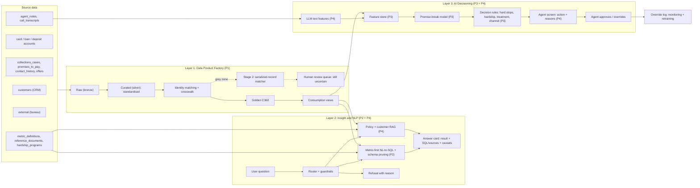
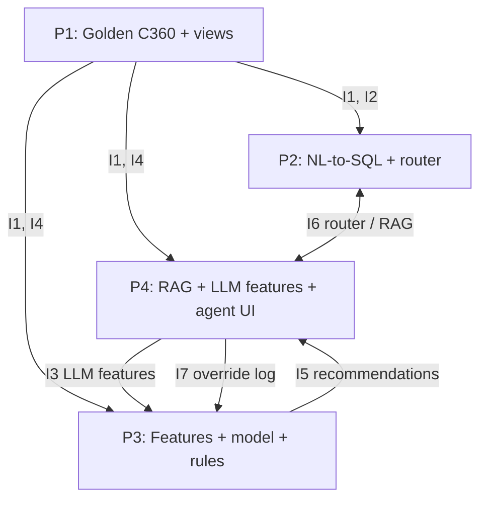

# CIBC Collections Hackathon: Team Plan (Next Best Action)

**Team:** `[Team Name]`
**Members:** P1 `[Name]` · P2 `[Name]` · P3 `[Name]` · P4 `[Name]`
**Design deadline:** 2 Oct, 11:00 PM IST · **Build phase:** 3 Oct 9:00 AM → 4 Oct 9:00 PM (36 hours)

Fields marked **TBC** are not confirmed in the data dictionary and must be checked when the dataset is released.

---

## 1. What we are building

| | |
|---|---|
| **Problem** | Each collections customer's story is split across cards, loans, deposits, CRM, collections, contacts, notes, transcripts and bureau data, each with its own customer key. Agents work blind, and treatments are not tailored to the customer. |
| **Use case** | **Next Best Action (NBA):** each day, for each customer in collections, recommend the right action (channel, timing, intensity or hardship route) with a plain-English reason, and route hardship or vulnerable cases to a trained human. Thin slice: three decisions (see 6.1). |
| **Users** | Collections agents (act on recommendations), team leads (ask questions, monitor), collections analytics (own metrics and models). |
| **Primary metric** | **Promise-kept rate:** share of promises to pay that are paid in full by the due date. |
| **Secondary metrics** | Cure rate (accounts returning to current), roll rate 1–30 → 31–60 (should go down), contacts per dollar recovered. Promise-kept rate can be gamed by taking only easy promises, so it is always read with cure rate and cost per recovered dollar. |
| **How we measure** | Hackathon: observational evidence only (see 6.7): model accuracy and calibration vs the existing `ptp_break` baseline, agreement with the incumbent `recommended_action`, and past outcomes where the action matched our recommendation vs not. We do **not** claim causal lift. Production: A/B test, NBA vs current strategy, with a control group. |

### One-sentence pitch

> We turn nine fragmented systems into one trusted customer record, let collections teams query it in plain English with the working shown, and recommend a fair, explainable next action for every customer, always with a human able to review it.

---

## 2. Key design decisions

1. **Identity resolution is the foundation.** Product systems use their own customer keys, and CRM itself contains duplicate records. We resolve everything to one `golden_customer_id` with a match confidence, and send uncertain matches to a human review queue.
2. **Protected attributes are removed at the data layer, from one registry.** The dictionary tags exactly 12 columns as `Protected attribute`. Layer 1 loads them into `ref.protected_attributes`, and the decisioning view, the feature-store allowlist and the Layer 2 refusal list are all generated from it. An automated test fails the build if a model feature is in the registry. Vulnerability and accessibility are used only *after* scoring, as safeguards, never as model inputs. Proxy risk (postal area, geo, housing, employer) is measured and reported, not assumed away.
3. **Metric-first NL-to-SQL.** Questions are mapped to certified metrics in `metric_definitions`; the LLM fills parameters, it does not invent definitions.
4. **Classical ML for numbers, LLMs for text.** One LightGBM model predicts promise breaks (reliable, explainable, testable). LLMs read notes and transcripts to extract hardship and delay-reason signals.
5. **Point-in-time correctness.** Every training feature is computed only from data available at the moment the promise was made. No leakage.
6. **Rules wrap the model.** Hard stops (consent, cease-contact, deceased, bankruptcy, dispute) run before any recommendation; hardship and vulnerability always trigger human review.
7. **Two-stage identity matching.** Splink handles the bulk of matching cheaply and explainably. A serialized-record matcher (each record flattened into one sequence with field-type tokens, inspired by MAMMAL and Ditto) judges only the uncertain middle band, before anything reaches a human.
8. **Schema pruning before NL-to-SQL.** A lexical index (radix trie compiled to Aho-Corasick) plus embedding search links question words to tables, columns and values. A Steiner tree over the gold-layer join graph finds the minimal join path. Only that pruned schema goes into the prompt, and the generated SQL is validated against it.

---

## 3. End-to-end pipeline flow



### The flow in plain words

1. **Raw data lands** in Layer 1 exactly as received (CSV, Parquet, JSON).
2. **Curation** standardises it: DOBs to ISO, phones to E.164, postal codes cleaned, names parsed, the latest snapshot per account selected.
3. **Identity matching** links every source record to one `golden_customer_id` and writes a crosswalk with match confidence. Uncertain matches go to a review queue.
4. **The golden C360** is built, checked against the data contract, and published with lineage and a data quality report.
5. **Consumption views** are cut from the golden data for each consumer: semantic views for NL-to-SQL, a customer timeline for RAG and the agent screen, and a protected-attribute-free decisioning view for the model.
6. **Layer 2** answers questions: the router sends each question to NL-to-SQL, RAG, or a refusal, and every answer shows its SQL or cited sources.
7. **LLM extraction** reads notes and transcripts and writes structured text features (hardship signal, delay reason, intent strength).
8. **The feature store** combines SQL features and LLM features, computed point-in-time.
9. **The model** scores each open promise for break probability.
10. **Decision rules** turn the score into an action, channel and timing, applying hard stops and hardship routing.
11. **The agent screen** shows the recommendation with plain-English reasons. The agent approves or overrides, and every override is logged.

---

## 4. Layer 1: Data Product Factory

**Owner:** P1

### 4.1 Stages

| Stage | What happens | Output |
|---|---|---|
| Raw (bronze) | Load files unchanged, add load timestamp and source file | `raw.*` tables |
| Curated (silver) | Standardise types and formats, deduplicate rows, keep latest snapshot per account | `silver.*` tables |
| Identity resolution | Match all customer references to golden IDs | `gold.customer_xref` |
| Golden (gold) | Build one record per person and per account | `gold.c360_customer`, `gold.c360_account` |
| Consumption views | Shapes for each downstream consumer | see 4.4 |

### 4.2 Identity matching

**The problem.** `card_accounts`, `loan_accounts` and `deposit_accounts` each use `src_customer_ref`; `external` uses `bank_subject_ref`. None links directly to CRM. CRM (`customers`) can hold more than one record per person, and collections, contacts, promises, notes and transcripts all use `crm_customer_id`, so CRM duplicates split a customer's history.

**Deterministic links come first.** `external.bank_subject_ref` equals the deposit account's core banking customer number, so bureau-to-deposit is an exact join (confirm on full data). `national_id_hash` exists **only in `customers`**, so it deduplicates CRM records but cannot link a card, loan or deposit record to CRM. `customers.duplicate_of_crm_id` is CRM's own incomplete duplicate pointer, used as a partial truth set to measure Stage 1. The crosswalk covers every table that carries a customer key, including `model_scores`, `salary_credit_history` and `account_monthly_snapshot` (all keyed on `crm_customer_id`) and `bureau_history` (keyed on `bank_subject_ref`).

**Matching fields per source:**

| Source | Name | DOB | Phone | Postal / address |
|---|---|---|---|---|
| customers | first/middle/last_name | date_of_birth | primary_phone_e164 | postal_code |
| card_accounts | cardholder_name_raw | cardholder_dob_raw | cardholder_phone_raw (masked) | cardholder_postal_raw |
| loan_accounts | borrower_name_raw | borrower_dob_raw | borrower_phone_raw | borrower_postal_raw |
| deposit_accounts | holder_name_raw | holder_dob_raw | holder_phone_raw | holder_postal_raw |
| external | subject_name_reported | subject_dob_reported | — | subject_address_reported |

Extra signals: `national_id_hash` (CRM only, confirmed), `deposit_accounts.payroll_descriptor_raw` fuzzy-matched to `customers.employer_name`.

**Method:**

1. **Standardise** every field (DOB formats → ISO; phone → E.164, masked digits treated as partial match; names → uppercase tokens, initials handled; postal → `A1A1A1`).
2. **Block** on DOB + FSA, and DOB + last name, to avoid comparing every record with every other.
3. **Exact pass:** link CRM duplicates where `national_id_hash` matches; link bureau to deposit on `bank_subject_ref`; link product records to CRM where name + DOB + phone match exactly.
4. **Probabilistic pass:** Splink (Fellegi-Sunter) scores remaining pairs on name similarity, DOB, phone, postal and employer.
5. **Route by Splink score:** ≥ 0.95 auto-link · 0.80–0.95 goes to the stage 2 matcher · < 0.80 stays separate. Thresholds tuned on a hand-checked sample.
6. **Stage 2 (grey zone only):** the serialized-record matcher below gives a second opinion. Pairs both stages agree on are linked; disagreements go to the human review queue.
7. **Cluster** linked records into one golden ID (connected components).
8. **Do not merge joint holders.** `joint_holder_ref` and `co_borrower_ref` become relationships, not identity evidence.

#### Stage 2 matcher: serialized records with field-type tokens

**The idea.** Borrowed from MAMMAL (npj Drug Discovery), which concatenates different kinds of biomedical data into one input sequence and uses special tokens to mark which part is which, so one model can reason across all of them. Applied here: each customer record from any source is flattened into one sequence, with tokens marking each field. The closest precedent in entity matching is Ditto (VLDB 2021), which serializes records as `[COL] field [VAL] value` and classifies pairs with a pre-trained transformer.

**Example input (one candidate pair):**

```
[SRC] card [NAME] R. MITCHELL [DOB] 1988-03-14 [PHONE] +1519555xxx42 [POSTAL] N9A4J2 [EMP] —
[SEP]
[SRC] crm [NAME] RYAN J MITCHELL [DOB] 1988-03-14 [PHONE] +15195550142 [POSTAL] N9A4J2 [EMP] LAKESHORE AUTO PARTS LTD
```

**Output:** match / no match, a probability, and a short reason naming the fields that decided it.

**Why it helps.** It handles cases rules and field-by-field scores struggle with: initials vs full names, nicknames (`preferred_name`), day/month swaps in DOB, masked phone digits, employer abbreviations (`payroll_descriptor_raw` "LAKESHORE AUTO PTS PAY" vs "Lakeshore Auto Parts Ltd."), and joint holders who share an address and phone but have different DOBs.

**Two implementation options:**

| Option | How | When |
|---|---|---|
| A. Zero-shot LLM (build default) | Pre-trained LLM reads the serialized pair and returns a JSON verdict with reasons. No training. | 36-hour build |
| B. Fine-tuned matcher (stretch) | Small transformer trained Ditto-style on weak labels: positives from exact `national_id_hash` or exact multi-field matches; negatives from same-block non-matches; joint holders as hard negatives. | If time allows, or production |

**Guardrails:**
- Runs only on the grey zone (thousands of pairs, not millions), which keeps cost and latency low.
- Cannot auto-link on its own: a link needs Splink ≥ 0.80 **and** a confident stage 2 verdict. Any disagreement goes to a human.
- Every decision stores both the Splink field weights and the stage 2 reason, for audit.
- Serialized records contain PII. Synthetic data is fine for the hackathon; in production the model must run in a bank-approved environment.

**Same pattern, second use:** the serialized-record format is reused to feed a customer's C360 record and timeline into the LLM that writes the agent-screen summary (P4).

### 4.3 Golden outputs

| Table | Grain | Key contents |
|---|---|---|
| `gold.customer_xref` | source record | source_system, source_key, golden_customer_id, match_confidence, match_method, matched_ts |
| `gold.c360_customer` | person | golden ID, best-available name/DOB/contact (survivorship rules), consent flags, cease/deceased/bankruptcy flags, product counts, totals, lineage, refresh_ts |
| `gold.c360_account` | account per snapshot | golden ID, product, balance, limit, DPD, bucket, hardship programme, dispute flags |

**Survivorship rule** (which value wins when sources disagree): CRM is the default. A product source overrides CRM only if its snapshot is newer and the field is one that changes over time (phone, postal code, employer). Each field records which source won.

### 4.4 Consumption views

| View | For | Notes |
|---|---|---|
| `gold.customer_timeline` | P4 (RAG, agent screen) | Contacts, promises, notes, offers per golden ID, in time order |
| `gold.bucket_transitions` | P2 (roll rate) | Account bucket at period start vs end. Must follow the certified `roll_rate` source tables (`card_statements`, `loan_instalments`, `card_accounts`, `loan_accounts`); check against `metric_definitions` (columns **TBC**) |
| Other semantic views | P2 | One per certified metric shape, requested by P2 |
| `gold.decisioning_customer` | P3 (features) | Golden customer **with all 12 registry attributes removed**; account-level features (e.g. `ccb_deposit_flag`) and voice features are covered too |
| `gold.safeguards_customer` | P3 (decision rules, after scoring) | Hard-stop and consent flags, `vulnerability_flag`, accessibility needs. Used to route and adjust service, never to score |

### 4.5 AI in Layer 1

- LLM suggests source-to-target column mappings; P1 reviews and approves.
- LLM drafts SQL transformations from the mapping; P1 reviews.
- Stage 2 serialized-record matcher judges uncertain identity matches (section 4.2).
- Schema drift detection: compare each load's columns and types to the contract.
- Anomaly detection on row counts and null rates per load, cross-referenced with `ops_events` to explain known outages.

### 4.6 Data quality report

Run every contract rule (section 8) on each load. Report pass rate per rule, matched vs unmatched records per source, match confidence distribution, and records in the review queue.

---

## 5. Layer 2: Insight and NLP

**Owners:** P2 (router, guardrails, NL-to-SQL, evaluation) · P4 (RAG)

### 5.1 Question flow

1. **Access check:** user role decides which data they can see (agents: assigned cases only; team leads: portfolio aggregates; analytics: full non-PII).
2. **Guardrail check (before any SQL or retrieval):** refuse if the question involves protected attributes, bulk direct PII, data outside the user's role, marketing use, or anything outside the allowed data. Every refusal gives a reason and a safe alternative.
3. **Router:** classifies into the six benchmark types: `metric`, `drivers`, `comparison`, `rag_corpus`, `rag_customer`, `guardrail`.
4. **Path:**
   - **Metric / comparison:** match to a certified metric using name, definition, synonyms and example question (embedding search over `metric_definitions`). LLM extracts parameters only (buckets, period, breakdown). SQL is built from the certified formula with `default_filters` applied automatically.
   - **Drivers:** compute the metric, then split by allowed dimensions (product, region, segment, salary gap, prior broken promises) and rank contributions. Protected attributes are never allowed as split dimensions.
   - **No certified metric found:** fall back to LLM-written SQL over the **pruned schema** (section 5.5), clearly labelled "uncertified".
   - Schema pruning also picks the tables and columns for drivers breakdowns and for filters in metric questions (e.g. "for mass-market customers").
   - **RAG:** see 5.3.
5. **SQL validation before running:** read-only, only tables in the metric's `source_tables` or the approved list, default filters present, no PII or protected columns selected, row limit.
6. **Answer card:** result, plain-English insight, SQL or cited sources, metric used, filters applied, resolved date range, caveats, suggested follow-ups. Parameters shown as editable chips.

### 5.2 Dates

Relative dates ("this month", "last 90 days") resolve against a configurable **as-of date** (benchmark `as_of_date`, e.g. 2026-09-28), never the system clock. The answer states the resolved range.

### 5.3 RAG (P4)

| Path | Corpus | Filters applied before similarity search |
|---|---|---|
| Policy (`rag_corpus`) | `reference_documents`, chunked by `section_ids` | Current version only (`superseded_by` empty, `effective_date` ≤ as-of date), product, province, language (EN/FR), confidentiality vs role |
| Customer (`rag_customer`) | `agent_notes`, `call_transcripts` | One golden ID (via crosswalk, so duplicate CRM records are included), user's case access, redacted text only (`redaction_status`, `pii_redaction_applied`), within `retention_until` |

Every RAG answer cites document ID, version and section, or note/transcript ID and date.

### 5.4 Evaluation (P2)

Automated harness over `benchmark_questions`: compares results to expected within `tolerance`, checks the right `metric_id` and `expected_tables` were used, checks `should_refuse` questions were refused, and scores against `grading_rubric` (numbers 60%, SQL/sources 20%, caveats 20%).

### 5.5 Schema linking and pruning (P2)

**Why.** The dataset has 31 tables and about 1,400 columns; `customers` and `card_accounts` alone have about 148 each. Putting the whole schema into the prompt bloats it, slows it, and invites the LLM to use the wrong column (e.g. card DPD instead of loan DPD) or an invented join. Research on text-to-SQL (RESDSQL, RAT-SQL) shows that linking and pruning the schema before generation improves accuracy.

**Steps:**

1. **Build the index once, at catalog sync (not per question).** It contains:
   - table and column names and their descriptions from the data dictionary;
   - metric names and `synonyms` from `metric_definitions`;
   - categorical values from `code_lookups` and enum columns (e.g. `segment` = `mass_market`, `ptp_status` = `broken`, `product` = `personal_loan`).
   Protected-attribute and direct-PII columns are **not indexed**, so they can never be linked. Protected terms (gender, citizenship, newcomer, marital status, etc.) are indexed instead as **refusal triggers** for the guardrail.
2. **Link the question to the schema (hybrid).**
   - *Lexical:* a radix trie compiled into an Aho-Corasick automaton finds every exact name, synonym and value in one pass over the question, in time proportional to the question length regardless of schema size. Fast and deterministic.
   - *Semantic:* embedding search over column descriptions and synonyms catches paraphrases the trie misses (e.g. "fell behind" → DPD; "reduced hours" → stated delay reason).
   - The union gives the **terminal tables and columns**. The LLM cannot use tables outside this set.
3. **Join graph over the gold layer, not raw tables.** Vertices are gold tables and views; edges are the foreign keys from the dictionary's Relationships sheet plus `golden_customer_id` via the crosswalk. Raw product tables have no foreign key to customers, so **Layer 1 is what makes this graph connected**.
4. **Steiner tree.** Find the minimal tree connecting all terminal tables (networkx Steiner-tree approximation; the graph is small, so this takes milliseconds). Edge weights encode preference: certified semantic views cheapest, direct foreign keys low, joins that risk double-counting rows (many-to-many, e.g. loans × cases on customer) heavily penalised.
5. **Prune columns too.** Keep linked columns, join keys, and a few key columns per table.
6. **Prompt** with only the pruned tables, columns, descriptions and allowed values.
7. **Validate after generation.** Hosted LLM APIs generally don't support grammar-constrained decoding, so we get the same guarantee by checking afterwards: parse with sqlglot; every table and column must be in the pruned schema; joins must follow the Steiner tree edges; read-only; row limit. On failure, re-prompt once with the error; if it fails again, say the question can't be answered reliably.

**Worked example (fields from the data dictionary; some values TBC):**

> "Which mass-market customers broke a personal loan promise last week after their hours were cut?"

| Phrase | Linked to | How |
|---|---|---|
| "mass-market" | `c360_customer.segment = 'mass_market'` | Trie (enum value) |
| "broke a … promise" | `promises_to_pay.ptp_status = 'broken'` | Trie (enum value + synonym) |
| "personal loan" | `promises_to_pay.product = 'personal_loan'` | Trie (enum value) |
| "last week" | `promises_to_pay.ptp_due_date` between 21 and 27 Sep 2026 | Date resolver, against as-of date 28 Sep 2026 |
| "hours were cut" | `llm_text_features.stated_delay_reason = 'reduced_income'` (value TBC) | Embedding match |

- **Terminal tables:** `c360_customer`, `promises_to_pay`, `llm_text_features`.
- **Steiner tree:** `promises_to_pay` → `customer_xref` (crm_customer_id → golden ID) → `c360_customer`; `llm_text_features` joins on golden ID.
- **Pruned away:** `loan_accounts` is not needed, because `promises_to_pay.product` already identifies the product. That also avoids a double-counting join.
- **Prompt:** 4 tables and roughly 15 columns, instead of the full schema.

**Claims we measure, not assert.** On the benchmark questions, run with and without pruning and report: schema-linking recall (did we keep every table the answer needed, per `expected_tables`), execution accuracy, prompt tokens, and latency. That comparison is a strong demo slide.

---

## 6. Layer 3: AI Decisioning (Next Best Action)

**Owners:** P3 (features, models, decision rules, explanations) · P4 (LLM features, agent screen)

### 6.1 What the NBA decides (thin slice)

The decision unit is a customer or case per day, not a promise. Three decisions:

1. **No open promise:** which channel and time slot gives the best chance of reaching the customer and getting a promise?
2. **Open promise:** reminder or agent call before the due date, driven by break risk and expected value.
3. **Hardship route:** when hardship or vulnerability is signalled, recommend a named hardship program (`hardship_programs.program_id`) for a human to approve.

Everything else (full action menu, uplift modelling) is a stretch goal.

### 6.2 Models

| Model | Predicts | Training data | Notes |
|---|---|---|---|
| Promise-break model | P(an open promise is broken) | `promises_to_pay`; label broken = (`broken`, `partially_kept`), kept = `kept`; `open`/`cancelled` excluded | LightGBM; baseline is existing `model_scores` where `model_name = 'ptp_break'`; compare AUC and calibration |
| Action-success model | P(kept promise or payment within N days \| customer, context, action) | `contact_history` (channel, `treatment_code`, outcome, `rpc_flag`), `collections_cases.treatment_path`, `offers` | One LightGBM model with the **action as an input feature**; score each allowed action and compare. N to be chosen from the data |
| Incumbent scores (reused) | Timing and channel models, `answer_rate_estimate`, `expected_recovery` | Existing `model_scores` | Used as inputs rather than rebuilt |

- **Features** are computed as of the decision time only (point-in-time). Time-based split: train on older data, validate on the next period, test on the most recent months (cut-offs set when data is loaded).
- **Leakage warning:** `card_accounts` and `loan_accounts` hold `dpd_m01..m12`, `worst_dpd_12m` and `times_30/60/90dpd_12m` measured at the 28 Sep 2026 snapshot. They must not be used for older decisions. Rebuild history features from `account_monthly_snapshot` as of the decision date, or use `promises_to_pay.dpd_at_creation` and `prior_broken_ptp_count`, which are already point-in-time. Current-state `customers` columns (e.g. `segment`, hardship fields) need the same care.
- **Missing data:** `transactions` covers only a customer sample, and transcripts only 25K calls, so features from them are null for most customers. The models accept nulls.
- **Selection bias:** past actions were chosen by the incumbent rules, so "calls worked better" may only mean calls went to easier customers. We control for DPD, bucket and prior behaviour, compare only customers who could have received either action, and look for any randomised or exploratory treatment in the data. Recommendations are described as "best action among similar past customers", to be confirmed by A/B test.
- Treatment of `partially_kept` to be confirmed against `metric_definitions`.

### 6.3 Feature store

| Feature | Source | Built by | Owner |
|---|---|---|---|
| max_dpd_current (across products) | c360_account | SQL | P3 |
| dpd history features (as of decision date) | account_monthly_snapshot | SQL | P3 |
| ptp_broken_count_90d, prior_broken_ptp_count | promises_to_pay | SQL | P3 |
| ptp_to_overdue_ratio, days_to_due_at_creation, dpd_at_creation | promises_to_pay | SQL | P3 |
| payroll_delay_days | deposit_accounts, salary_credit_history | SQL | P3 |
| card_utilisation | card_accounts | SQL | P3 |
| bureau_score_delta_90d | external | SQL | P3 |
| contact_response_rate_30d (by channel), rpc_count_prior_30d | contact_history | SQL | P3 |
| hardship_signal (none / possible / clear) | agent_notes, call_transcripts | LLM | P4 |
| stated_delay_reason (category) | agent_notes, call_transcripts | LLM | P4 |
| ptp_intent_strength (0–1) | call_transcripts | LLM | P4 |
| dispute_mentioned (bool) | agent_notes | LLM | P4 |

The store is an **allowlist**: only registered features are exposed, so a newly added column stays out until approved. Each feature is registered with name, entity, type, source, refresh, owner, and (for LLM features) prompt version and accuracy. One definition serves both training (offline) and scoring (online). No registry attribute is ever a feature. `age` and `age_band` are excluded from features and drivers by policy and used only in the fairness test.

### 6.4 LLM feature extraction (P4)

- Input: redacted notes and transcripts **dated before** the scoring point (point-in-time).
- Output: strict JSON with closed enum values per the feature schema (interface I3), so no free text passes through.
- Testing: hand-label ~200 notes; also compare against agent-coded `contact_history.hardship_mentioned_flag` as a weak label. Report precision and recall per feature, and measure whether the features track protected attributes.
- Notes mentioning disability, newcomer status or similar route to a human; they never raise a risk score.
- Coverage: notes (~1.5M) cover far more contacts than transcripts (25K), so notes are the main source. Missing text features are allowed.

### 6.5 From scores to action (P3)

Applied in this order:

1. **Hard stops:** `cease_communication_flag`, `deceased_flag`, `bankruptcy_flag`, open dispute, `insolvency_hold_flag` → no collection contact; route to the specialist queue.
2. **Channel consent and contact caps:** only consented channels are eligible (`consent_call`, `consent_sms`, `consent_email`, `consent_push`, `consent_autodialer`); respect contact caps from `code_lookups` (`contact_rule_set`); use `contact_ts_local` for timing and agent language / `french_queue` for routing.
3. **Hardship / vulnerability safeguard:** hardship_signal possible/clear, or `vulnerability_flag` → recommend a hardship conversation with a `vulnerable_customer_certified` agent. Check eligibility deterministically against `hardship_programs` (`min_hardship_level`, `max_dpd`, `excludes_broken_plan_90d`, `approver_level`) and recommend a specific `program_id`. **Human approval required.** Accessibility needs adjust channel and agent, never the score.
4. **Choose the action:** for each eligible action, expected value = P(success) × promised or overdue amount − `unit_cost_cad` (from `channel_capacity`). For open promises, break risk sets the intensity: low → reminder on the best consented channel, medium → reminder plus scheduled follow-up, high → agent call at the best time slot.
5. **Capacity allocation:** rank customers by expected value and fill each channel and time band up to `capacity_units` (skip channels with `outage_flag`).

### 6.6 Explanations

- Two parts. **Why this risk:** SHAP values → top 3 reasons. **Why this action:** the factors that favoured it over the alternatives (for example no SMS reply in 30 days, 18:00–20:00 is the top slot, consent granted, program eligible).
- Rendered through a fixed template; an LLM may polish wording but cannot change the reasons.
- Example: *"High break risk (0.81): 2 promises broken in the last 90 days, salary credit 29 days late, notes mention reduced shifts. Call preferred over SMS: no SMS reply in 30 days; best slot 18:00–20:00. Recommend hardship call by a certified agent, program HP-LOAN-RED3 eligible. Approval required."*

### 6.7 Evidence we report (observational, not causal)

- Accuracy and calibration of the break and success models vs the `ptp_break` baseline.
- Agreement with the incumbent `model_scores.recommended_action`, and how many actions we would have changed.
- Outcomes (kept rate, cure rate) where the past action matched our recommendation vs where it did not, labelled observational.
- Per-action calibration of predicted vs actual success.
- A capacity-aware simulation of one day's recommendations against `channel_capacity` and cost.
- A fairness table across protected groups (action mix, hardship-offer rate, error rates).
- Production would use an A/B test with a control group.

### 6.8 Human in the loop

- Every customer-affecting action shows on the agent screen before it happens.
- Mandatory approval: hardship, vulnerability, high-value accounts, and any case where the model is uncertain (score near the threshold).
- Override requires a reason code; overrides are logged and reviewed weekly as monitoring and retraining signal.

---

## 7. Governance (all layers)

| Area | How we handle it |
|---|---|
| Access control | Role-based: agents see assigned cases only; team leads see aggregates; PII columns masked unless role allows |
| Protected attributes | The 12 dictionary-tagged attributes (10 in `customers`, `deposit_accounts.ccb_deposit_flag`, `voice_samples.customer_accent_region`) live in `ref.protected_attributes`; views, feature allowlist and refusal list are generated from it; an automated test blocks them from model features. Proxy test on `fsa`, `geo_lat/lon`, `urban_rural`, `housing_status`, `sub_segment`, `employer_name`, `fsa_income_index`; model metadata records `uses_protected_attributes = false` |
| Hardship and vulnerability | Detected from structured flags and LLM text features; always trigger human review and specialist routing |
| Hard stops | Cease-contact, deceased, bankruptcy, dispute and consent applied before any recommendation |
| Text data | Only redacted notes and transcripts enter LLMs; retention dates respected |
| Monitoring | Data: contract checks, drift, anomalies. Model: AUC, calibration, PSI, override rate. LLM features: accuracy on a labelled sample each release |
| Fairness check | Compare model error rates, action mix and hardship-offer rates across protected groups (restricted test environment only, never as features) |
| LLM text features | Closed enum outputs only; measure whether they track protected attributes; notes mentioning disability or newcomer status route to a human, never raise a risk score |
| Audit | Every answer and recommendation logged with SQL/sources, model version and feature snapshot |

---

## 8. Draft data contract: `gold.c360_customer`

| Field | Value |
|---|---|
| Owner | Head of Collections Data (business) · P1 (technical) |
| Grain | One row per resolved person (`golden_customer_id`) |
| Refresh | Daily batch; intraday updates for payments and contacts (stretch) |
| Freshness SLA | ≤ 24 hours behind source snapshot |

**Quality rules:**

1. `golden_customer_id` is unique and not null.
2. Every source customer record appears in `customer_xref` with exactly one golden ID, or is flagged unmatched.
3. Auto-linked records have `match_confidence` ≥ 0.95. Pairs from 0.80 to 0.95 are linked only if Stage 1 and Stage 2 agree; disagreements must be in the review queue. No pair below 0.80 is linked.
4. `date_of_birth` parses to a valid date; derived age between 18 and 110.
5. Bureau `risk_score` falls within the declared model range (note: 300–900 in `external` vs 300–850 in `bureau_history` per the dictionary, to be reconciled).
6. No column from `ref.protected_attributes` appears in the decisioning view or the model feature store (automated test).
7. Snapshot is no older than 24 hours.

**Allowed uses:** collections operations, collections analytics, NBA model training and scoring.
**Not allowed:** marketing, credit decisions outside collections, any use of protected attributes in decisions.

---

## 9. How each person's pieces link up

### 9.1 Interfaces (agree these first)

| # | From → To | Interface | Contents | Needed by |
|---|---|---|---|---|
| I1 | P1 → all | Golden schema | `golden_customer_id` format, `c360_customer` and `c360_account` columns | Tonight (design) / Build H+4 (sample data) |
| I2 | P1 → P2 | Semantic views + join graph | `bucket_transitions` and any view each certified metric needs; gold-layer table list with join keys (edges for the Steiner pruner); enum value lists for the trie | Build H+8 |
| I3 | P4 → P3 | LLM feature schema | `{golden_customer_id, source_id, source_ts, hardship_signal, stated_delay_reason, ptp_intent_strength, dispute_mentioned, prompt_version}` | Tonight (schema) / Build H+12 (data) |
| I4 | P1 → P3, P4 | Decisioning view + customer timeline | Protected-attribute-free customer data; time-ordered interactions | Build H+8 |
| I5 | P3 → P4 | Recommendation format | `{golden_customer_id, action, channel, time_slot, break_prob, top_reasons[3], explanation_text, hardship_flag, approval_required, blocked_reasons[]}` | Build H+16 |
| I6 | P2 ↔ P4 | Router → RAG | Router passes `{question, question_type, golden_customer_id?, user_role, as_of_date}`; RAG returns `{answer, citations[]}` | Build H+12 |
| I7 | P4 → P3 | Override log | `{recommendation_id, agent_id, decision, reason_code, ts}` | Build H+24 |

### 9.2 Dependency map



**Unblocking rule:** nobody waits for real upstream data. Each person builds against a small mock version of their input interface from hour 0, and swaps in real data when it arrives.

---

## 10. Per-person responsibilities

### P1: Data Engineer (Layer 1)

| | |
|---|---|
| **Owns** | Raw → silver → gold pipeline, identity matching, crosswalk, review queue, consumption views, data contract, data quality report |
| **Inputs** | All source files |
| **Outputs** | I1, I2, I4; data contract file; DQ report |
| **Tools** | DuckDB, Parquet, dbt (or SQL scripts), Splink, Great Expectations or Soda, LLM API for the stage 2 matcher (Hugging Face transformer if fine-tuning) |
| **Design doc sections** | Layer 1, data contract (page 6), Scalability (batch) |
| **Build tasks** | (1) Load raw + mock golden sample for the team, (2) standardisation, (3) exact + Splink matching, (4) stage 2 serialized-record matcher on the grey zone, (5) golden tables + views + join-graph metadata, (6) contract checks + DQ report, (7) drift/anomaly checks |

### P2: NL-to-SQL Lead (Layer 2, structured)

| | |
|---|---|
| **Owns** | Access check, guardrails, router, schema index + Steiner pruner, metric matching, parameter extraction, SQL generation and validation, answer card logic, benchmark evaluation |
| **Inputs** | I2 semantic views, `metric_definitions`, `benchmark_questions` |
| **Outputs** | Ask API (question → answer card); evaluation report on benchmark questions |
| **Tools** | LLM API, embedding model, pyahocorasick (trie / Aho-Corasick), networkx (Steiner tree), sqlglot (SQL validation), DuckDB |
| **Design doc sections** | Layer 2, Scalability (real time) |
| **Build tasks** | (1) Load metrics + embed synonyms, (2) router + guardrails, (3) schema index (trie + embeddings) and Steiner pruner, (4) parameter extraction + templated SQL, (5) validator against the pruned schema, (6) drivers/comparison paths, (7) benchmark harness with and without pruning |

### P3: ML Engineer (Layer 3, decisioning)

| | |
|---|---|
| **Owns** | SQL features, feature store, point-in-time training set, promise-break and action-success models, SHAP explanations, decision rules, baseline comparison, fairness check |
| **Inputs** | I4 decisioning view, I3 LLM features, `promises_to_pay`, `model_scores`, `hardship_programs`, `channel_capacity` |
| **Outputs** | I5 recommendations; model card (AUC, calibration, baseline comparison, fairness results) |
| **Tools** | Python, pandas, LightGBM, SHAP, MLflow (optional) |
| **Design doc sections** | Layer 3, Business value |
| **Build tasks** | (1) Training set with point-in-time features on mock data, (2) SQL features on real data, (3) train + evaluate vs baseline, (4) action-success model, (5) SHAP → reason templates, (6) decision rules + hard stops + capacity allocation, (7) fairness check and proxy test |

### P4: LLM and Product Lead (unstructured AI + agent experience)

| | |
|---|---|
| **Owns** | Policy RAG, customer RAG, LLM feature extraction, agent screen, human review and override flow, architecture diagram, governance narrative, final consistency check |
| **Inputs** | `reference_documents`, `agent_notes`, `call_transcripts`, I4 customer timeline, I5 recommendations |
| **Outputs** | I3 LLM features, RAG service (I6), agent UI, override log (I7) |
| **Tools** | LLM API, Chroma or FAISS, Streamlit |
| **Design doc sections** | Architecture diagram (page 1), Summary, AI usage, Governance |
| **Build tasks** | (1) LLM feature prompt + hand-labelled sample, (2) batch extraction over notes, (3) policy RAG with version filters, (4) customer RAG with access filters, (5) agent screen (C360 view, recommendation, reasons, approve/override), (6) Ask screen front end for P2's API |

### Shared

- **Use case and metric:** whole team (decided: NBA, promise-kept rate).
- **Build plan section:** whole team, 20 minutes, once sections are drafted.
- **Demo video and pitch deck (if selected as finalist):** P4 leads storyline; each person records their own segment.

---

## 11. Tonight's timeline (2 Oct)

| Time (IST) | Who | Work |
|---|---|---|
| 5:00–5:45 | All | Read data dictionary; confirm table groupings and keys |
| 5:45–6:15 | All | Confirm NBA + metric; agree interfaces I1, I3, I5 |
| 6:15–8:30 | Each | Draft own sections (see section 10); P4 drafts architecture diagram |
| 8:30–9:00 | All | Build plan discussion |
| 9:00–9:45 | P1 / P4 | P1 finalises data contract; P4 finalises diagram |
| 9:45–10:30 | P4 + all | Merge into one PDF; consistency check on names, tools, IDs |
| 10:30–10:45 | All | Final read; check 6 pages, file name, names on page 1, no code |
| **10:45** | P4 | **Submit `TeamName_SystemDesign.pdf`** |

**PDF layout:** p1 architecture diagram (with team and member names) · p2–5 design doc · p6 data contract.

---

## 12. 36-hour build plan (if selected)

**Must-have thin slice:** golden C360 for all sources → Ask demo on benchmark questions with SQL shown and refusals → one trained promise-break model with explanations → agent screen with approve/override.

| Hours | P1 | P2 | P3 | P4 |
|---|---|---|---|---|
| 0–4 | Load raw; publish mock golden sample (I1) | Load metrics; router + guardrails; build trie index from data dictionary | Training-set code on mock data | LLM feature prompt; label ~200 notes |
| 4–12 | Standardise; exact + Splink matching | Metric matching + templated SQL; Steiner pruner on mock join graph | SQL features on early golden data | Batch extraction; policy RAG |
| 12–20 | Stage 2 matcher on grey zone; golden tables; views + join graph (I2, I4) | Validator against pruned schema; drivers/comparison | Train model; compare to baseline | Customer RAG; agent screen skeleton |
| 20–28 | Contract checks; DQ report | Benchmark harness incl. with/without-pruning comparison; fix failures | SHAP reasons; decision rules (I5) | Wire recommendations + override (I7) |
| 28–32 | Drift/anomaly checks | Ask UI polish with P4 | Fairness check; model card | End-to-end demo flow |
| 32–36 | **All:** freeze code, rehearse demo, record video, finish deck, submit by 9:00 PM 4 Oct |

**Stretch goals (only after the thin slice works):** channel-response model from `contact_history`; intraday refresh; voice-sample features; French-language RAG.

---

## 13. Demo storyline (5 minutes)

1. **The problem (30s):** one customer, five systems, five different IDs.
2. **Layer 1 (60s):** the same customer resolved to one golden ID with confidence and lineage; DQ report.
3. **Layer 2 (90s):** team lead asks "Which customers are most likely to break a promise this week?", sees SQL and caveats; asks a protected-attribute question and gets refused with a reason.
4. **Layer 3 (90s):** agent opens a high-risk customer; NBA recommends a hardship call, with reasons citing a note about reduced shifts and the current hardship policy section; agent approves.
5. **Impact and governance (30s):** model accuracy vs the existing baseline, how many actions we would change and what the past outcomes show (labelled observational); protected attributes excluded by construction and tested; human always in the loop.

---

## 14. Risks and mitigations

| Risk | Mitigation |
|---|---|
| Identity matching takes too long at 1M+ customers | Blocking; develop on a sample; run full match overnight |
| Teams blocked waiting on upstream data | Mock interfaces from hour 0 (section 9.2) |
| Data leakage inflates model performance | Point-in-time features (rebuild history from `account_monthly_snapshot`, never `dpd_m01..m12` or `worst_dpd_12m` for old decisions); time-based split; P2 or P1 reviews the training-set logic |
| Past actions were chosen by the old rules, so success rates are biased | Control for DPD, bucket and history; compare only like customers; call results observational; A/B test in production |
| Low transcript coverage (25K of ~2.5M contacts) | Use notes as the main text source; model accepts missing text features |
| LLM extraction slow or costly over 1.5M notes | Extract only for customers with open cases / promises in the training window; cache results |
| RAG returns superseded policy | Metadata filter on version and effective date before similarity search |
| Scope creep | Thin slice first; stretch goals only after the slice works end to end |
| Stage 2 matcher over-merges different people | It can never link alone: needs Splink ≥ 0.80 and agreement; disagreements go to humans; joint holders used as hard negatives in testing |
| Trie misses paraphrased questions | Hybrid linking: embedding search runs alongside the trie |
| Pruner drops a table the answer needs | Measure schema-linking recall against `expected_tables`; if recall is low, keep a wider neighbourhood around terminal tables |
| Shortest join path double-counts rows | Penalise many-to-many edges; prefer certified views; validator checks joins follow the Steiner tree |

---

## 15. Open items (TBC when data arrives)

- ~~Whether `national_id_hash` exists outside `customers`~~ **Resolved: only in `customers`.** Still open: whether any product record carries a CRM key.
- Exact columns for `bucket_transitions` and other semantic views.
- ~~`model_scores.model_name` for the break model~~ **Resolved: `ptp_break`.**
- How `metric_definitions` treats `partially_kept` promises.
- Whether the bureau score range difference (900 in `external` vs 850 in `bureau_history`) is a model version change or a data error.
- Benchmark question count and how many are `should_refuse`.
- Whether `code_lookups` covers all enum values needed for the trie, or distinct values must be read from the data.
- Whether any ground-truth identity links are released (would let us measure matching accuracy and train the stage 2 matcher).

---

## 16. Submission checklist (tonight)

- [ ] File named `TeamName_SystemDesign.pdf`
- [ ] Team name and all member names on page 1
- [ ] ≤ 6 pages: diagram (1) + design doc (≤ 4) + data contract (1)
- [ ] All nine design-doc headings present: Summary, Business value, Layer 1, Layer 2, Layer 3, AI usage, Scalability, Governance, Build plan
- [ ] Diagram shows all three layers, named tools, where AI is used, where humans review
- [ ] Data contract has owner, schema, 3+ quality rules, allowed uses, refresh frequency
- [ ] No code
- [ ] Unconfirmed fields marked TBC
- [ ] Table, tool and ID names consistent across all pages

---

## 17. Research backing

| Idea | Source | What it supports |
|---|---|---|
| Serialized multi-type input with marker tokens | MAMMAL (IBM Research; npj Drug Discovery) | One model reading several data types concatenated, with tokens marking each part |
| Serialized-record entity matching | Ditto: Deep Entity Matching with Pre-Trained Language Models (VLDB 2021) | `[COL]/[VAL]` record serialization for match / no-match classification |
| Probabilistic record linkage | Fellegi-Sunter model (1969), implemented in Splink | Explainable per-field match weights without labelled data |
| Schema linking before generation | RESDSQL (AAAI 2023), RAT-SQL (ACL 2020) | Pruning or linking the schema first improves text-to-SQL accuracy |
| Steiner trees over relational schemas | BANKS (ICDE 2002), DISCOVER (VLDB 2002) | Minimal join networks connecting the tables a query mentions |
| Constrained SQL generation | PICARD (EMNLP 2021), Synchromesh (ICLR 2022) | Restricting output to valid SQL; we apply the same idea as post-generation validation |

