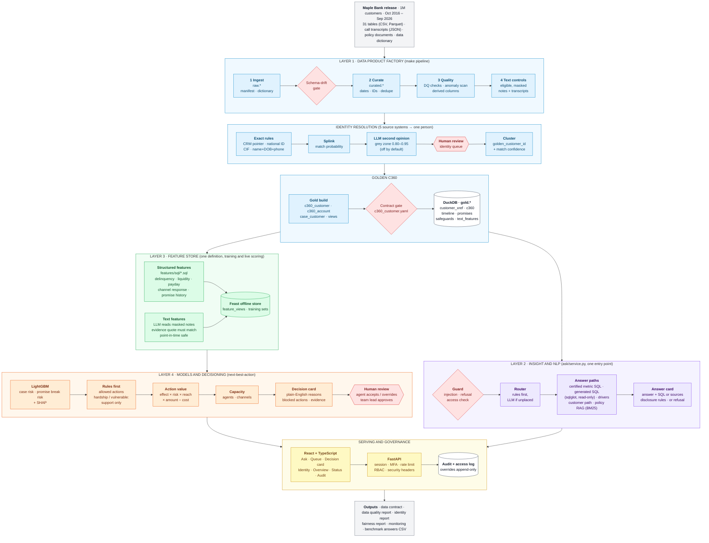
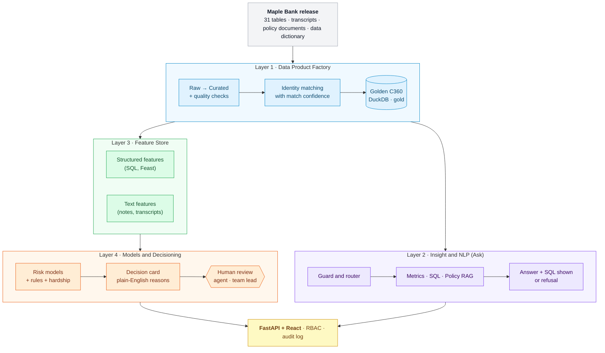
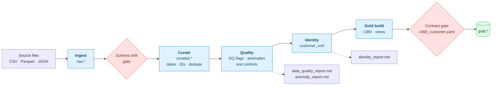
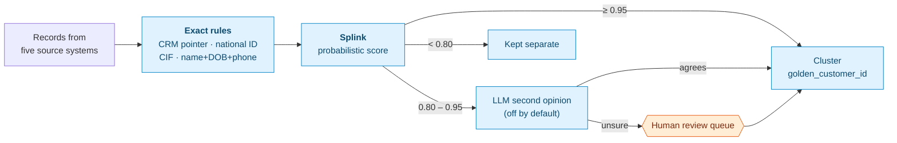
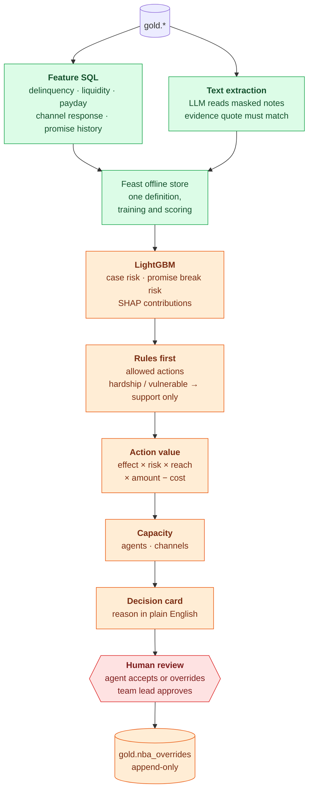
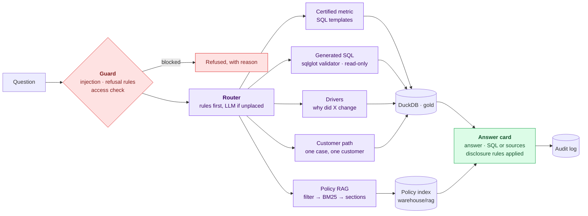
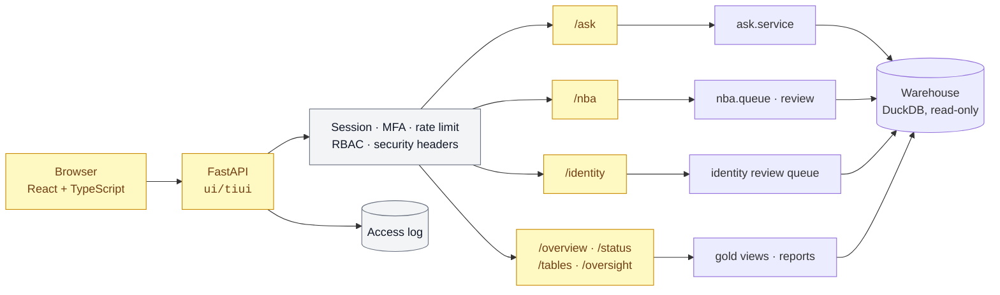

# TrustIssues: Architecture

One overview, then one close-up per layer. Diagrams are Mermaid; GitHub renders them in place.
Sources: `src/trustissues/`, `ui/`, `config/`, `contracts/`, `Makefile`.

## Full architecture

Everything in one view. Image: [full.png](architecture/full.png), PDF: [full.pdf](architecture/full.pdf).

## 1. Overview

## 2. Layer 1: Data Product Factory

Run with `make pipeline` (`factory/pipeline.py`). A stage can resume with `--from <stage>`.

### Identity matching, cheapest and surest first

## 3. Layer 3 and 4: features to decisions

Every feature comes from one SQL file in `features/sql/`, read by both training and live scoring.

## 4. Layer 2: Ask

One entry point, `ask/service.py`, used by the app and the benchmark runner. Nothing bypasses the guard.

## 5. Serving and governance

