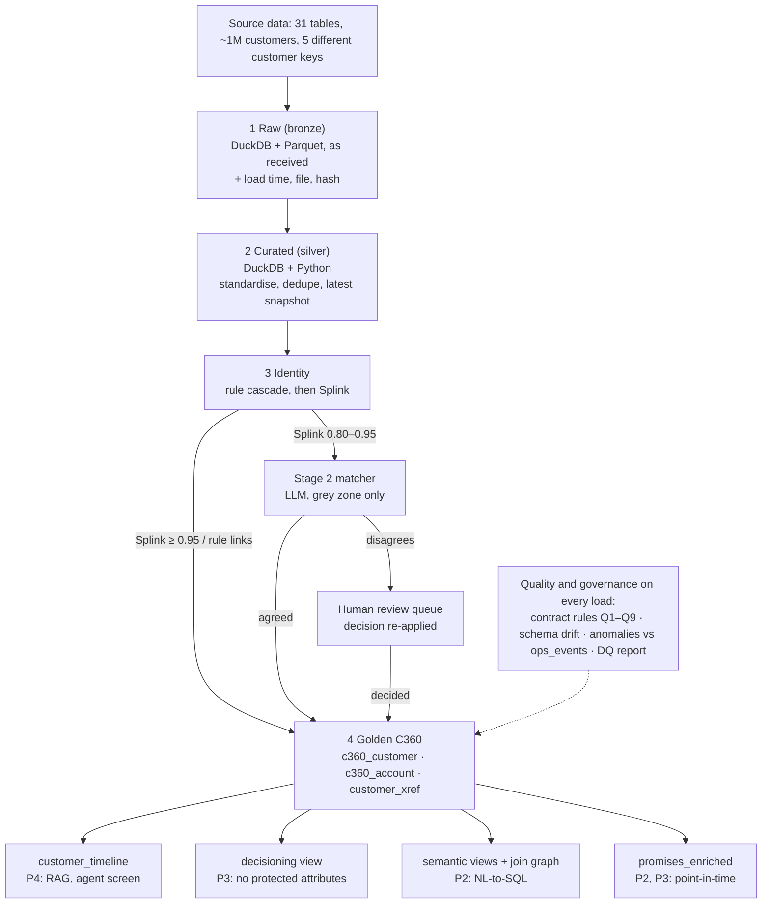
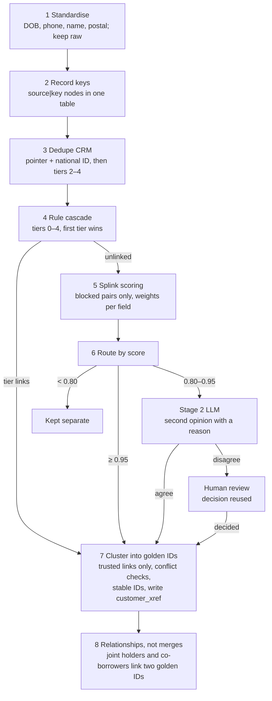

# Layer 1: Data Product Factory (P1 Design)

Layer 1 turns 31 fragmented source tables into one governed Collections 360 record per customer. This document sets out its architecture, design decisions, matching logic, batch latency and data contract. Owner: P1. Consumers: P2 (NL-to-SQL), P3 (features and model), P4 (RAG and agent screen).

## 1. Architecture

Data moves one way, from raw files to a golden record and then to one view per consumer; only uncertain identity matches branch off to the LLM and a person.

- **Sources (31 tables):** CRM `customers`, `card_accounts`, `loan_accounts`, `deposit_accounts`, `collections_cases`, `contact_history`, `promises_to_pay`, `agent_notes`, `call_transcripts`, `external` (bureau), plus history tables in Parquet by year. About 1M customers, 1.84M accounts and over 55M history rows.
- **Bronze (raw):** files loaded exactly as received, with audit stamps. Nothing is changed.
- **Silver (curated):** types cast, matching fields standardised, duplicate rows removed, latest snapshot selected per account.
- **Identity:** every source record resolved to one `golden_customer_id` through rules, Splink, the stage 2 LLM matcher and human review.
- **Gold (C360):** `gold.c360_customer` (one row per person), `gold.c360_account` (one row per account per snapshot) and `gold.customer_xref` (source key → golden ID).
- **Consumer views:** customer timeline (P4), decisioning view (P3), semantic views (P2), promises view (P2, P3).
- **Quality gate on every load:** contract rules, schema drift and anomaly checks run before gold is published.
- **Engine:** DuckDB over Parquet on a single machine; Python for standardisation; Splink for matching; an LLM API for the grey zone; Great Expectations / Pandera for quality checks.

## 2. Key design decisions

Every decision favours trust over speed: a missed link can be fixed later, but a wrong merge shows a customer someone else's debt.

1. **Medallion layers (bronze → silver → gold → views).**
   - Why: each stage can be checked and re-run alone; bronze is the permanent audit copy.
   - Rejected: one script from source to final table.
2. **Identity resolution before anything else.**
   - Why: five different customer keys plus CRM duplicates mean nothing joins without it.
   - Rejected: each consumer joins sources its own way.
3. **Match in passes, cheapest and surest first.**
   - Why: rules settle most records at no cost; only hard cases need Splink, the LLM or a person.
   - Rejected: score every pair with a model or LLM.
4. **AI never links two records on its own.**
   - Why: a grey-zone link needs Splink and the LLM to agree.
   - Rejected: trust the LLM verdict directly.
5. **Uncertain cases go to a person, and the decision is reused.**
   - Why: keeps a human in the loop and the same pair is never asked twice.
   - Rejected: auto-decide on one threshold.
6. **Phone is never a merge key on its own.**
   - Why: spouses, parents and joint holders share phones; phone is always paired with DOB.
   - Rejected: merge on equal E.164 phone.
7. **Joint holders and co-borrowers are relationships, not merges.**
   - Why: they share address and phone, the classic cause of false merges.
   - Rejected: treat shared contact details as proof.
8. **Cluster only trusted links, then check each cluster for conflicts.**
   - Why: connected components can chain two families through one bad link.
   - Rejected: cluster every accepted pair.
9. **When undecided, keep records separate.**
   - Why: a missed link is recoverable; a false merge is not.
   - Rejected: merge on balance of probability.
10. **Protected attributes physically removed from the model view.**
    - Why: the model cannot use what is not there.
    - Rejected: keep them and filter at query time.
11. **A safety flag from any source wins.**
    - Why: cease-contact, deceased, bankruptcy and dispute must never be missed.
    - Rejected: pick one best source per flag.
12. **Every golden value records its source and time.**
    - Why: agents can trust it and errors can be traced back.
    - Rejected: store the value only.
13. **Single-node DuckDB + Parquet, not a Spark cluster.**
    - Why: handles this volume on one machine within the 60-minute window, with no infrastructure to run.
    - Rejected: Apache Spark.

## 3. Medallion pipeline

Each stage writes its own schema and never edits the one before it, so any stage can be rebuilt from the previous one.

### Bronze: raw staging

- Load every source file (CSV, Parquet by year, JSON transcripts) exactly as received, with no schema change, type casting or filtering.
- Stamp every row with `_ingested_at`, `_source_file`, `_batch_id` and `_row_hash` (hash of all source columns).
- Write a load manifest per file: row count, column list, checksum.
- Run the schema drift check against the contract before anything moves on.
- Output: `raw.<table>`. Guarantee: a full audit copy; every later stage can be rebuilt from it.

### Silver: standardised and curated

- **Cast types** per the data dictionary; a value that fails to cast becomes empty, is flagged, and keeps its raw text.
- **Standardise matching fields:**
  - Date of birth → ISO 8601 (`YYYY-MM-DD`); ambiguous day/month keeps both readings.
  - Phone → E.164 (`+15195550142`); masked card phones keep only their visible digits as a partial value.
  - Name → uppercase tokens, accents removed, parsed into first / middle / last; initials kept.
  - Postal code → `A1A1A1`, plus the FSA (first 3 characters, e.g. `N9A`).
  - Employer → uppercase, legal and payroll words removed (`LTD`, `INC`, `PAY`), abbreviations expanded.
- **Keep raw values** next to every standardised value for audit.
- **Deduplicate** exact duplicate rows on `_row_hash`.
- **Temporal snapshot selection:** current CRM version (`effective_to_ts = 9999-12-31`); latest `snapshot_date` per card, loan and deposit account, with full history kept in separate history tables.
- **Validate enums** against `code_lookups`; tag every column with its sensitivity (Direct PII, Quasi-identifier, Protected attribute).
- **Text controls:** notes marked `needs_review` for redaction, or past `retention_until`, are excluded downstream.
- Tools: DuckDB, Python `phonenumbers`, `dateutil`, `nameparser`, `unidecode`, `rapidfuzz`.
- Output: `silver.<table>`. Guarantee: the same fact looks the same in every source.

### Identity

- Resolve every source record to one `golden_customer_id` (section 4).
- Output: `gold.customer_xref`, `gold.identity_review_queue`, `gold.customer_relationship`.

### Gold: Collections 360

- **`gold.c360_customer`:** one row per person; each field chosen by survivorship (section 5) and stored with its source and time.
- **`gold.c360_account`:** one row per account per snapshot, all products in one shape (golden ID, product, balance, limit, DPD, bucket, hardship and dispute flags).
- **Roll-ups onto the customer:** product count, total balance, total overdue, maximum current DPD, worst bucket.
- **Safety flags** unified across sources (section 5).
- **Lineage on every row:** source systems, match confidence, refresh time, quality status.
- Published only after the contract's blocking rules pass. Tools: DuckDB, Great Expectations / Pandera.

### Consumer views

- One view per consumer, cut from gold (section 6); consumers never read raw or silver data.

## 4. Identity resolution

- **The problem:** card, loan, deposit and bureau records each use their own customer key, and none links directly to CRM. CRM itself holds duplicate people.
- **The opportunity:** collections cases, contacts, promises, notes and transcripts already point to the CRM ID. Once CRM is deduped and products are linked to it, a customer's whole story connects.
- **The approach:** two stages. Stage 1 is rules plus Splink; stage 2 is an LLM second opinion for the grey zone only. A person settles disagreements.

### Step 1: Standardise

- Matching fields made identical in format across sources, as in silver (section 3).
- CRM primary, secondary and work phones are all standardised; any of them can match.
- Tools: DuckDB, Python.

### Step 2: Give every record a key

- One node per source customer, prefixed with its source: `crm|RYM-1142`, `card|CX0048213`, `loan|B00553092`, `dep|0007730115`, `bur|0007730115`.
- One node per customer, not per account: a customer with three cards is one node.
- All nodes stacked into one table with the same matching columns.

### Step 3: Dedupe CRM

- Merge CRM records that are the same person, before linking any other system.
- First, CRM's own `duplicate_of_crm_id` pointer (trusted where present, but incomplete).
- Then, same `national_id_hash` (the hashed government ID, which exists only in CRM).
- Then, for records with no hash, the rule tiers below.
- Same hash but clearly different DOBs → not linked; sent to review.

### Step 4: Rule cascade

- Each card, loan, deposit and bureau node is compared with CRM nodes.
- A pair links at the first tier it meets; the tier is stored as its method.
- A conflict on a strong identifier (different national ID hash, clearly different DOB) blocks any weaker tier.
- **Tier 0:** bureau `bank_subject_ref` equals deposit `src_customer_ref` (both described as the bank CIF; to verify). Highest confidence.
- **Tier 1:** same `national_id_hash` (CRM to CRM). Highest confidence.
- **Tier 2:** name + DOB + full phone all equal. Very high.
- **Tier 3:** DOB + full phone equal, with a compatible name (initials allowed). High.
- **Tier 4:** DOB + full name + postal equal. High.
- Unlinked records go on to Splink.

### Step 5: Splink scoring

- **Blocking:** only pairs sharing DOB + FSA, DOB + last name, or DOB + phone are compared, avoiding the all-pairs O(N²) comparison.
- **Fields compared (Fellegi-Sunter model):** name (Jaro-Winkler similarity, initials), DOB (exact, day/month swapped, year off by one), phone (full, or visible digits of masked phones), postal (full or FSA only), employer (`payroll_descriptor_raw` vs `employer_name`).
- **Training:** no labels needed; Splink learns field weights from the data itself.
- **Output:** a match probability and a weight per field for every pair, so each score is explainable.

### Step 6: Route by score

- **≥ 0.95:** linked automatically.
- **0.80–0.95 (grey zone):** sent to the stage 2 matcher.
- **< 0.80:** kept as separate people.

### Stage 2 matcher (grey zone only)

- **Idea:** borrowed from MAMMAL (npj Drug Discovery), which marks each data type with special tokens in one input, and Ditto (VLDB 2021), which serialises records for entity matching.
- **Input:** both records flattened into one tagged sequence: `[SRC] card [NAME] R. MITCHELL [DOB] 1988-03-14 [PHONE] 519555xxx42 [POSTAL] N9A4J2 [SEP] [SRC] crm [NAME] RYAN J MITCHELL [DOB] 1988-03-14 [PHONE] +15195550142 [POSTAL] N9A4J2`.
- **Model:** a zero-shot LLM for the build; a fine-tuned Ditto-style transformer as the stretch option.
- **Output:** match or not, a probability, the deciding fields and a one-line reason.
- **Handles:** initials, nicknames, day/month swaps, masked digits, employer abbreviations.
- **Resolution gate:** linked only when Splink is in the band and the LLM says match; any disagreement goes to the human review queue, and the person's decision is re-applied on every rerun.

### Step 7: Cluster into golden IDs

- Linked pairs form a graph; connected components turn them into people.
- Only trusted links are clustered: tiers 0–2, Splink ≥ 0.95, Splink-and-LLM agreement, or human-confirmed.
- A cluster with two different DOBs, two national ID hashes or more than 5 CRM records is not merged; it goes to review.
- Golden IDs (`G-000000`) stay the same across reruns by reusing the ID of the cluster's oldest CRM record.
- Records that matched nothing get their own golden ID (`singleton`), so no account is dropped.
- Every link written to `gold.customer_xref` with method and confidence.

### Step 8: Relationships, not merges

- `joint_holder_ref` and `co_borrower_ref` stored as links between two golden IDs in `gold.customer_relationship`.
- Never used as identity evidence, and a joint-holder pair can never be clustered as one person.

### When we can't decide or can't merge

The default for any unresolved case is **keep separate**: a missed link can be fixed later, but a false merge shows a customer someone else's debt and history.

- **Splink 0.80–0.95 but the LLM disagrees:** not linked. The pair goes to the human review queue with both explanations; the records keep separate golden IDs until a person decides.
- **Reviewer is unsure:** marked `unresolved` and kept separate. It resurfaces only if new evidence arrives, such as a new phone or a verified DOB.
- **Splink below 0.80:** not linked; each record keeps its own golden ID.
- **One record matches two different CRM people at the same tier:** ambiguous, not linked; sent to review with no automatic tie-break.
- **Strong identifiers conflict** (same phone but different `national_id_hash`, or clearly different DOBs): blocked, never merged by a weaker rule; logged as `blocked_conflict`.
- **A cluster fails a conflict check** (two DOBs, two hashes, more than 5 CRM records): not merged; split along its weakest links, which go to review.
- **Joint holder or co-borrower pair:** never merged; stored as a relationship between two golden IDs.
- **Too little data to compare** (no DOB, masked phone only): cannot pass any rule tier; goes to Splink, and stays separate if it scores below 0.80.
- **Product or bureau record with no CRM match:** singleton with its own golden ID, flagged `unmatched` in the quality report; its accounts stay visible as "identity not confirmed".
- **Every outcome is recorded** in `gold.customer_xref` with a status (`linked`, `in_review`, `unresolved`, `blocked_conflict`, `singleton`), so the quality report shows how many cases are open and why.

## 5. Survivorship and safety rules

When matched sources disagree, a fixed precedence decides the golden value, and every golden field stores which source won and when.

### Survivorship precedence

1. **Verified value wins:** `email_verified_flag`, `income_verified_flag`, complete KYC, or contact details confirmed on a call (`contact_history.identity_verified_flag`).
2. **Otherwise CRM wins** over product systems.
3. **Otherwise the most recently updated source wins** (`last_profile_update_ts`, `snapshot_date`, `extract_ts`).
4. **Bureau-reported identity** is matching evidence only and never overwrites bank data.
5. **Lineage:** each resolved field in `gold.c360_customer` stores `<field>_source` and `<field>_as_of`.

### Safety flags: any source is enough

Survivorship does not apply here; if any one source raises the flag, the golden flag is on.

- **Cease contact:** CRM `cease_communication_flag`, case `cease_contact_flag`, or contact `cease_request_flag`.
- **Deceased:** CRM `deceased_flag`, case `deceased_hold_flag`, or bureau `deceased_indicator`.
- **Bankruptcy:** CRM `bankruptcy_flag` or bureau `bankruptcy_on_file_flag`.
- **Open dispute:** case `dispute_status = open` or card `dispute_open_flag`.
- **Channel consent** (`consent_call`, `consent_sms`, `consent_email`, `consent_push`, `consent_autodialer`): if CRM duplicates disagree, the most restrictive value wins.

### Other rules

- Notes and transcripts are used only if redacted and within `retention_until`.
- Bureau scores always carry their `risk_score_model`, because `external` uses 300–900 and `bureau_history` 300–850.

## 6. Consumer views and compliance firewall

Each teammate reads one view cut for their purpose, so nobody touches raw data and nobody sees fields they must not use.

### Views

- **`gold.customer_timeline` (P4: RAG, agent screen):** contacts, promises, agent notes, transcripts, offers and payments per golden ID, in time order. Redacted text only; CRM duplicates merged through `customer_xref`.
- **`gold.bucket_transitions` (P2: roll rate):** each account's bucket at period start vs end, to track roll-rate movement. Columns confirmed with P2 when metrics land (TBC).
- **`gold.semantic_*` + join graph (P2: NL-to-SQL):** one view per certified metric shape, the gold table connections, and allowed enum values. Protected and PII columns are never indexed.
- **`gold.promises_enriched` (P2, P3):** one row per promise with golden ID and `ptp_created_ts`, so features use only what was known when the promise was made.
- **`gold.decisioning_customer` (P3: feature store and model):** the compliance firewall, below.
- **`gold.customer_safeguards` (P3: decision rules after scoring):** vulnerability, accessibility, hardship and safety flags. Used to protect customers, never to score them.

### Compliance firewall: `gold.decisioning_customer`

- **Allow-list design:** the view lists the columns it allows, so a new source column can never leak in by default.
- **Protected attributes removed (all 12 tagged in the dictionary):** `gender_code`, `marital_status`, `citizenship_status`, `household_size`, `dependants_count`, `newcomer_program_flag`, `newcomer_arrival_date`, `accessibility_needs_flag`, `accessibility_type`, `vulnerability_type` (CRM), `ccb_deposit_flag` (deposits), `customer_accent_region` (voice).
- **Direct PII removed:** names, DOB, phones, email, address, `national_id_hash`, note and transcript text.
- **Exact location removed:** `geo_lat`, `geo_lon`.
- **Single entry point:** the feature store connects only to this view.
- **Proxy watch:** removing columns does not remove proxies, so `fsa`, `fsa_income_index` and `age` are flagged for P3's fairness check, which compares outcomes across protected groups (testing only, never as features).
- **Why:** supports Canadian fair-treatment expectations for collections and the brief's rule of no protected attributes in decisions.

## 7. AI usage in Layer 1

AI suggests and P1 approves: no AI output reaches gold without a review or a rule check.

- **Source-to-target mapping:** the LLM reads each source column's name, type, description and example from the data dictionary and proposes its C360 target field and transform. P1 accepts or edits each mapping, low-confidence rows first.
- **SQL transformation code:** the LLM drafts silver and gold SQL from approved mappings. Code review and tests run before anything is merged.
- **Identity grey zone:** the stage 2 serialised-record matcher (section 4). It cannot link alone; disagreements go to a person.
- **Schema drift detection:** each load's columns, types and enum values are compared with the contract; the LLM suggests the likely rename for a changed column. Removed or retyped columns stop the load.
- **Anomaly detection:** row counts and null rates more than 3 standard deviations from recent loads are flagged and matched to `ops_events` (system, time window, `affected_tables`). Explained anomalies are labelled; unexplained ones alert P1.

## 8. Batch workflow and latency

The full daily batch, raw files to published golden data, targets about **42 minutes** on one machine, inside a **60-minute** window and without a distributed cluster such as Apache Spark. All times are targets, to be measured on the real data.

### Batch schedule

- Source extracts land between about 02:00 and 05:00 ET (`extract_ts`).
- The batch starts after the last extract and publishes golden data by about 06:00 ET.
- Freshness: golden data is never more than 24 hours behind the source snapshot.

### Workflow with latency

1. **Raw ingestion and normalisation (bronze → silver): ~12 min** (cumulative 12 min)
   - Bronze load of all 31 tables with audit stamps; unchanged rows skipped by row hash: ~5 min.
   - Silver casting, standardisation, row dedupe and latest-snapshot selection: ~7 min.
2. **Rule cascade, blocking and Splink matching: ~18 min** (cumulative 30 min)
   - CRM dedupe and rule tiers 0–4 as SQL joins: ~4 min.
   - Splink scoring of ~1M customer records within DOB-based blocks: ~14 min.
3. **Stage 2 serialised matching on the grey zone: ~5 min** (cumulative 35 min)
   - ~5,000 borderline pairs sent to the LLM in parallel requests.
4. **Gold build, views and quality gate: ~7 min** (cumulative **~42 min**)
   - Clustering, conflict checks and `customer_xref`: ~2 min.
   - `c360_customer`, `c360_account` and the consumer views: ~3 min.
   - Contract rules, drift and anomaly checks, quality report; publish only if blocking rules pass: ~2 min.

### How the engine meets the window

- **Columnar compression and projection:** large history tables (`loan_instalments` ~20M rows, `transactions` ~10M, `card_statements` ~8M, `salary_credit_history` ~6M, `bureau_history` ~5M) are stored as Snappy-compressed Parquet partitioned by year. Each query reads only the columns and years it needs.
- **Vectorised, multi-threaded execution:** DuckDB processes joins and window functions in vectors of 2,048 values using SIMD instructions, across all CPU cores, with no cluster coordination overhead.
- **Out-of-core memory safety:** when a join on multi-million-row history exceeds available memory, DuckDB spills intermediate data to disk instead of failing.
- **Blocking:** avoids the all-pairs comparison of ~1M records.
- **Bounded LLM load:** only the grey zone reaches the LLM, and stored human decisions are re-applied, not re-asked.
- **Production path:** the same SQL runs on a cloud warehouse (for example Databricks or Snowflake) with an orchestrator such as Airflow if volume grows.

## 9. Data contract: `gold.c360_customer`

The contract is the formal promise `gold.c360_customer` makes to everyone who uses it. It is kept as one machine-readable file that both documents the product and drives the automated checks, so the two cannot drift apart.

### Product specification

- **Product:** `gold.c360_customer` v1.0, Collections 360 customer record.
- **Domain:** retail collections and recovery.
- **Business owner:** Head of Collections Data.
- **Technical owner:** P1.
- **Grain:** strictly one row per resolved person (`golden_customer_id`).
- **Refresh:** daily batch after source extracts; published by about 06:00 ET.
- **Freshness SLA:** ≤ 24 hours behind the source snapshot.
- **Classification:** restricted; contains direct PII.
- **Access:** agents see their assigned cases only; team leads see aggregates; analytics see non-PII data; PII masked by default.

### Schema

- **`golden_customer_id`** (string, primary key): format `G-000000`, stable across runs.
- **`source_keys`** (JSON): every linked source key: CRM IDs, card, loan and deposit `src_customer_ref`, bureau `bank_subject_ref`.
- **`match_method`** (string): strongest method across the cluster's links: tier, splink, stage2, human or singleton.
- **`match_confidence`** (decimal, 0.80–1.00): lowest confidence among the cluster's links; empty for singletons.
- **`full_name`, `date_of_birth`** (string, date): chosen by survivorship, each with `_source` and `_as_of`. Direct PII.
- **`segment`, `province_code`** (string): as in CRM, e.g. `mass_market`, `ON`.
- **`consent_call`, `consent_sms`, `consent_email`, `consent_push`, `consent_autodialer`** (boolean): most restrictive across CRM duplicates.
- **`cease_contact`, `deceased`, `bankruptcy`, `open_dispute`** (boolean): true if any source says so.
- **`hardship_flag`** (boolean): hardship recorded on any case or account.
- **`product_count`, `total_balance`, `total_overdue`** (int, decimal): rolled up from `gold.c360_account`.
- **`max_dpd_current`, `worst_bucket`** (int, string): worst across open accounts; buckets as in the source (`current`, `1-30`, `31-60` …).
- **`payroll_delay_days`** (int): from deposit accounts.
- **`active_ptp_status`** (string): current promise: `open`, `kept`, `partially_kept`, `broken`, `cancelled` or none.
- **`source_systems`, `refresh_ts`, `dq_status`** (array, timestamp, string): lineage and quality status.

### Quality rules (Great Expectations / Pandera, every load)

**Block publish if they fail:**

1. `golden_customer_id` is unique and not null (100%).
2. Every source record appears in `gold.customer_xref` exactly once (100%).
3. No link below 0.80; links between 0.80 and 0.95 only through stage 2 agreement or human review.
4. None of the 12 protected attributes, and no direct PII, in `gold.decisioning_customer` (0%).
5. A safety flag true in any source is true in gold.

**Warn and report if they fail:**

6. `date_of_birth` valid; derived age 18–110.
7. Balances and `max_dpd_current` ≥ 0; customer totals equal the sum of accounts.
8. Bureau score within its scoring model's range.
9. `refresh_ts` ≤ 24 hours old.

### Allowed and prohibited uses

- **Allowed:** collections operations, next-best-action scoring and recommendations, hardship identification, frontline agent assistance, collections analytics and reporting.
- **Prohibited:** marketing and cross-selling, credit decisions outside collections, any decision using protected attributes, any customer-affecting action without human review.
