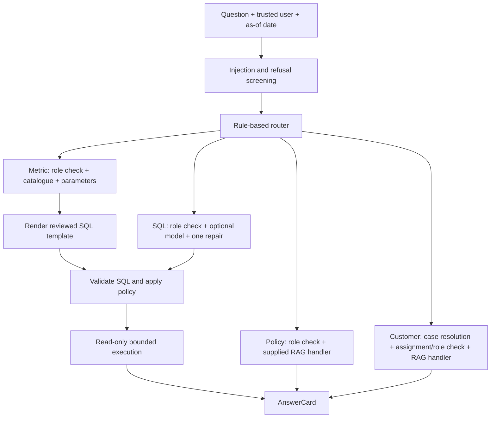

# P2 implementation documentation

Snapshot: 3 October 2026, branch `p2-branch-ask-layer`, committed HEAD `aa65feb`, plus the working-tree additions listed below. This documents code inspected in the shared checkout, including both Claude's and Codex's contributions. It is an implementation record; [the v2 plan](p2_plan.md) and [plan review](p2_plan_review.md) explain the intended design and earlier decisions.

Subsequent same-day update: two benchmark-specific templates (`out_of_hours_share`, `dispute_count`) have been added beyond the 15 catalogue metrics described in this snapshot. Their interfaces and the requested Claude/P1 review are recorded in [the integration handoff](p2_claude_handoff.md). Catalogue/service wiring for those IDs remains Claude's next step.

The metric Ask path is implemented and connected end to end on fixtures. All 15 catalogue metric templates exist, with a separate 30-day cohort cure variant. Access checks, refusal screening, SQL validation, read-only execution, and benchmark submission generation exist. Policy RAG and generated-SQL integration are being added in the working tree. Customer-call retrieval, real-data certification, and production publish integration remain incomplete.

## 1. Contributions and file ownership

Paths below are relative to the repository root. Ownership records the agreed implementation lanes, rather than assuming the last Git committer authored every file.

| Lane | Implemented files | Responsibility |
|---|---|---|
| Claude: Ask orchestration | `src/trustissues/ask/types.py`, `service.py`, `router.py` | User/answer types, common Ask entry point, deterministic routing |
| Claude: metric selection | `src/trustissues/ask/catalog.py`, `asof.py` | Trigger catalogue, dimensions, cohort/variant selection, date parameters |
| Claude: access and screening | `src/trustissues/ask/access.py`, `refusal.py`, `injection.py` | Role and case access, refusal lexicon, injection heuristics |
| Claude: benchmark | `src/trustissues/ask/benchmark.py`, `scripts/run_benchmark.py`, `scripts/score_dev.py` | Submission runner and approximate development scorer |
| Codex: query safety and execution | `src/trustissues/ask/data/validator.py`, `execute.py` | Structural SQL validation, trusted scopes, row/runtime caps, read-only execution |
| Codex: metrics and semantic contracts | `src/trustissues/ask/data/semantic.py`, `semantic_adapters.py`, `metric_templates.py`, `metric_sql/*.sql` | Six semantic shapes, isolated development adapters, bounded metric rendering |
| Codex: relationships | `src/trustissues/ask/data/schema_graph.py` | Dictionary relationship graph, multiplicity, proposed join paths |
| Codex: quality helpers (removed at the P2 merge, see §8) | `src/trustissues/factory/quality/contract_checks.py`, `anomaly.py`, `check_report.py` | Eight contract checks, statistical anomalies, contract/anomaly Markdown report |
| P4 integration dependency | `src/trustissues/ask/rag/*.py`, `src/trustissues/common/llm.py`, `audit.py` | Policy ingestion/search/answering and shared model/audit support; see [P4 build notes](p4_policy_rag_build.md) |
| P1 integration dependency | `src/trustissues/factory/quality/dq_report.py` | Anushka's curated-data diagnostics/report pipeline; distinct from `check_report.py` |

Claude remains the single editor for dependency metadata, configuration, shared interfaces, and service wiring. Both agents share one checkout and branch; changes are immediately visible. Stage only explicit owned files. Do not switch branches or operate on the worker warehouse while loading/curation holds it.

### Working-tree additions at this snapshot

`ask/rag_handler.py`, `ask/sql_fallback.py`, their two test files, and `scripts/build_ask_dev.py` are untracked. `ask/service.py` and `scripts/run_benchmark.py` have local modifications connecting the new paths. These additions passed the fixture checks below, but are not yet committed at the documented HEAD. The router and its tests were also modified during this documentation pass to introduce an `incident` route. `scripts/curate_parallel.py` is untracked and belongs to the ongoing curation work, outside this P2 implementation inventory.

## 2. Ask flow and public types

The common entry point is:

```python
ask(question, user, *, as_of_date, con=None, database=None,
    rag=fake_rag, resolver=None, llm=None) -> AnswerCard
```

`UserContext(user_id, role)` accepts `agent`, `team_lead`, or `analyst`. It checks the role value; authentication and a trusted user ID must come from the application. The function takes an explicit dataset date and never derives it from today's system clock.

The actual order is injection screening, refusal screening, routing, then path-specific access and execution:



The router prefers recognised metric triggers, identifies case-specific call questions, routes policy wording to corpus RAG, and sends other analytical wording to generated SQL. Its latest local change gives “why did … drop/spike” explanations an `incident` route. The service explicitly returns `cannot_answer` with an incident-evidence-unavailable note until metric evidence and cited incident records are connected. A case ID by itself is not a customer-call request. Routing is regex-based; no embedding or model-based router is implemented.

`AnswerCard` contains the question, answer, path, as-of date, refusal flag/reason, metric ID, SQL, `certified`, structured columns/rows, sources, and notes. Metric rows are also rendered as CSV text, with floats rounded to four decimal places. The `certified=True` field currently identifies the reviewed-template path; it does **not** establish real-data certification. A template returning no groups produces “No rows matched.”

Metric cards currently retain the template SQL with placeholders, rather than the validator's rewritten SQL or a parameter audit record. RAG cards retain citation kind/ID/section strings but discard richer response metadata such as version and evidence. There is no complete Ask-level audit trail, editable-filter UI, or follow-up interface yet.

## 3. Access, refusals, and injection screening

| Path | Agent | Team lead | Analyst |
|---|---|---|---|
| Portfolio metric | Denied | Allowed; validator requires aggregates | Allowed |
| Generated SQL | Denied | Allowed; validator requires aggregates | Allowed |
| Policy RAG | Allowed | Allowed | Allowed |
| Customer RAG | Assigned case only | Allowed | Denied |

`check_case` requires a resolver returning `CaseOwner(golden_customer_id, assigned_agent_id)`. Missing and unassigned cases return the same denial wording. `connection_resolver(con)` provides a parameterised lookup against `gold.semantic_cases`; callers must wire it explicitly. The benchmark CLI does not currently supply a customer resolver.

The lower-level validator supports agents with trusted per-table row scopes, including nested scans. The current Ask service deliberately denies agents the portfolio SQL/metric paths and does not construct those scopes. A future customer-query integration must supply authorised identifiers from trusted access code.

`config/refusal_lexicon.yaml` defines protected-attribute, proxy-geography, bulk-PII-export, and out-of-scope refusals. `config/sensitivity.yaml` independently controls blocked SQL column names. Injection screening checks instruction overrides, prompt leakage, role claims, debug/admin wording, writes, readers, and SQL smuggling. This is a deterministic heuristic screen, not the planned classifier or a guarantee against every injection.

## 4. Dates, catalogue, and metric definitions

`asof.parse_periods(question, as_of)` produces half-open `[start, end)` periods. It supports full English month names with years, day ranges, multi-month ranges, month ends, a number of months ending on an explicit date, contextual bare years, and today/currently/right-now wording. Inclusive human day-range endings become exclusive next-day boundaries. Catalogue period ends are capped at `as_of + 1 day`.

General relative phrases such as “last week”, “last month”, and “last 90 days” are not implemented. `days_before(period, n)` exists as a helper but is not a complete comparative-period integration. Invalid calendar dates can raise errors. Missing periods produce `Unsupported` for most metrics; promises and contact attempts have disclosed all-history defaults.

Metric identity, grouping dimensions, date basis, cohort, and requested output measure are separate concepts. The current catalogue implements a subset of those choices through trigger rules and `MetricCall`; it is not an automatic interpreter of every row in `metric_definitions.csv`.

| Metric template | Implemented definition / important boundary |
|---|---|
| `promise_kept_rate` | Due-date cohort; known kept/partial/broken outcomes; partial counts in denominator only |
| `broken_promise_rate` | Same eligible cohort; broken outcomes in numerator |
| `collected_amount` | Payments against promises in payment-date window; not all recoveries |
| `rpc_rate` | True RPCs divided by outbound canonical-channel call attempts |
| `ptp_rate` | PTP made among RPC contacts divided by RPC contacts |
| `cost_per_contact` | Contact costs per contact, excluding system events |
| `cost_per_rpc` | Contact costs per true RPC, excluding system events |
| `cure_rate` | Cases open at period start, cured during period; holds excluded |
| `cure_rate`, variant `cohort_30d` | Matured opening cohort cured within 30 days; separate SQL asset |
| `hardship_rate` | Structured hardship flag in the case-opening cohort |
| `average_dpd` | Open cases with observed current DPD; current release state |
| `delinquency_rate` | Active/blocked snapshot accounts with observed DPD; optional card product restriction |
| `write_off_rate` | Charge-off count / snapshot account population; also returns count and amount |
| `contact_attempts_per_case` | Open cases left-joined to outbound contacts, retaining zero-contact cases |
| `payroll_delay_share` | Eligible payroll customers with delay greater than seven days |
| `roll_rate` | Paired month-end accounts moving to a worse canonical DPD bucket; optional hold exclusion |

There are **15 distinct metrics and 16 SQL assets**, counting the extra cure variant. Percentages use 0–100 percentage points; empty rate denominators return NULL. Exact parameters and all six view grains are in [semantic view contracts](semantic_views.md), backed by `semantic.SCHEMAS`.

`render_metric` accepts only known metrics/variants, up to three distinct approved grouping dimensions, and exactly the required scalar parameters. Values are bound separately from SQL; identifiers come from allow-lists. Prior broken promises can be capped into a final group; the catalogue uses a cap of three. Date windows must increase. Roll-rate starting ranges must be canonical buckets with a possible worse bucket.

### Release traps already reflected, and decisions still open

- The contact contract exposes the supplied `within_permitted_hours_flag`; generated-SQL instructions say to use it rather than invent province-time conversions.
- Promise site uses a left join and `coalesce(site, 'self_serve')`, preserving unmatched/self-serve promises.
- Monthly snapshots depend on P1's curated date recovery. P2 adapters do not recover lost raw dates themselves; mixed source date formats must be preserved upstream.
- Both stored `reported_bucket` and recomputed `canonical_bucket` exist. BQ-035's primary interpretation is stored-bucket counts; quantifying disagreement against DPD is still a separate integration task.
- BQ-008 has a distinct opening-cohort cure variant. BQ-014's certification-at-assignment pilot needs a reviewed additional shape; generic cure must not be presented as an equivalent answer.
- Write-off rate, count, and amount are separate outputs. The development scorer does not yet verify all measures together.
- Roll-rate catalogue defaults currently follow the development reference with `exclude_holds=False`; the catalogue/reference disagreement must remain explicit.
- Current case/account state cannot reconstruct history. Comprehensive rejection of unsupported historical wording is not implemented; some catalogue paths use the as-of/current snapshot despite other dates in a question.

## 5. Semantic adapters and relationship graph

`create_semantic_fixtures(con)` creates empty contract tables only in memory. `build_dev_adapters(con, development_database=True)` creates six views over eight curated source tables plus `gold.customer_xref`. File databases must end in `_ask_dev.duckdb`. The function checks key uniqueness before replacing views and builds the views transactionally.

Crosswalk joins include a source-system discriminator and linked/singleton status. Unresolved customers remain NULL. Contacts use `coalesce(channel_v2, channel)` and retain local timestamps. Accounts include cards and loans; monthly snapshots retain history across products. Payroll aggregates eligible account delays per customer/snapshot. Since the release has no loan status field, non-charged-off loans are labelled `unknown`; an active-loan population rule still needs review.

The untracked `scripts/build_ask_dev.py` copies eight curated tables to `warehouse/ask_dev/trustissues_ask_dev.duckdb`, applies interface stubs, and builds adapters. It **reads the worker warehouse** through a read-only attachment and deletes/rebuilds its development output. Do not run it until the warehouse is released. Applying stubs does not populate a real golden crosswalk; identity-dependent answers still need P1 integration.

`SchemaGraph.from_dictionary(path, primary_keys=...)` reads the dictionary Relationships sheet into a multigraph. Edges carry columns and multiplicity, with additional crosswalk relationships requiring source-system conditions. `join_path(tables)` proposes an approximate Steiner tree penalising uncertain/fan-out joins. Unknown multiplicity remains unknown. Proposed dictionary joins do not become permitted SQL joins automatically: the validator uses explicitly approved `SEMANTIC_JOIN_KEYS`. Graph-based query planning is not connected to Ask yet.

## 6. SQL validator, executor, and generated fallback

`validate(sql, QueryPolicy(...)) -> ValidatedQuery` uses sqlglot to inspect the complete query, including aliases, CTEs, and nested selects. It checks tables, columns, lineage, functions, and approved equality joins. It rejects multiple statements, writes/DDL, set operations, recursive CTEs, table/file/network readers, and unapproved syntax/functions. Blocked PII, quasi-identifiers, protected attributes, and configured proxies remain blocked through aliases.

Team leads must return aggregates and cannot group by entity IDs. Non-agent outputs cannot expose entity identifiers except permitted aggregate uses such as counts. Trusted `row_scopes` and `required_filters` are installed inside each underlying table scan, so an outer OR or subquery cannot remove them. Agent scans without an authorised scope fail; empty scopes return no rows. Reserved `__ti_scope_` parameters cannot be overridden. The output LIMIT is bounded by policy (default 500, maximum 10,000).

`execute(validated_query, scalar_parameters, *, con=..., database=...) -> QueryResult` accepts a validated query and exactly one connection source. Injected connections must be in memory; file connections are read-only. **Since 4 Oct (Ask page):** an injected *file* connection is accepted too (the app holds the warehouse for writing, and DuckDB refuses a second connection to the same file in one process): the query runs on its own cursor inside `BEGIN TRANSACTION READ ONLY`, always rolled back, so DuckDB itself refuses any write and the caller's connection and open transaction are untouched (`tests/test_execute.py`). It returns columns, rows, and elapsed milliseconds. The default timeout is five seconds, using interrupt and synchronisation to prevent a timer affecting a later execution. These objects are trusted internal interfaces, not an HTTP security boundary: never construct a `ValidatedQuery` from unchecked user SQL.

The working-tree `run_fallback` asks the shared model for one SELECT using schema names/types/notes, without sending database rows. Generated SQL goes through the same role policy, validator, and executor. A failed query gets one repair attempt; a second failure returns cannot-answer. Successful results use `certified=False`. Without `llm=...`, SQL questions return an explicit unavailable answer. Tests use a scripted model; model quality and real-data answers were not validated in this documentation pass. Initial model-call failures can still propagate; the metric service also does not yet catch every DuckDB/missing-database error.

## 7. Policy and customer RAG integration

P4 supplies policy chunking, metadata/version filtering, BM25 retrieval, section expansion, jurisdiction handling, hardship table attachment, and cited answer generation. Vector retrieval and reranking have hooks rather than completed providers. Shared model support includes retries, cache, JSON output, and model-call auditing. See [P4 build notes](p4_policy_rag_build.md) for those modules' own documentation.

The working-tree `make_rag_handler(index, llm)` connects corpus requests to P4's `answer_policy`. A model outage becomes a not-found response with coverage information. Customer requests explicitly return “customer notes and calls are not connected yet.” Ask defaults to `fake_rag` unless a caller supplies a handler.

**Since the P2 merge (4 Oct):** `make_rag_handler(index, llm, con=...)` sends customer requests to P4's `customer_path.answer_customer`, `RagRequest` has a `case_id` field, and `access.case_customer_resolver(con, as_of)` resolves cases on the published warehouse. The paragraph above and the one below describe the branch before the merge. See `merge.md` §6 and `docs/interfaces.md`.

Customer access wiring is present, but retrieving the latest recorded call for a particular case is not. P2/P4 still need a case-to-customer-to-call selection contract; a customer timeline alone is insufficient. `RagRequest` currently carries the golden customer ID and original question, without a dedicated case-ID field. Role-to-document confidentiality mapping also remains a P4 integration decision.

Policy retrieval may attach hardship rows by opening the warehouse. The current handler does not expose the standalone policy CLI's no-hardship option. Consequently the benchmark `--llm` path is not safe to run during the worker lock just because its metric database is isolated.

## 8. Quality checks, anomalies, and the two reports

**Superseded at the P2 merge (4 Oct).** `run_checks`, `check_report.py` and `ops_anomaly.py` (P2's anomaly helper) were removed: the eight checks repeated P1's contract rules Q1-Q9 one for one, and the two they added were folded into `contracts/c360_customer.yaml` (overdue totals in Q7, build age as Q10). P1's `quality/anomaly.py` is the one anomaly detector. One publish gate: `contract_checks.run()`. See `merge.md` §6. The text below records P2's design.

`contract_checks.run_checks` checks the gold stub-shaped products using two explicit clocks: dataset `as_of_date` for age, and real batch `checked_at` for freshness.

| Rule | Check | Severity |
|---|---|---|
| 1 | Golden customer IDs unique and nonempty | Block |
| 2 | Every independent source record mapped or explicitly flagged | Block |
| 3 | Automatic links below 0.95 confidence confirmed | Block |
| 4 | Decisioning columns satisfy sensitivity rules and explicit approved allow-list | Block |
| 5 | Independent source safety flags propagated | Block |
| 6 | DOB/age plausible (18–110 at dataset date) | Warn |
| 7 | Customer totals reconcile to latest account snapshots within one cent | Warn |
| 8 | Refresh no more than 24 hours old at batch clock | Warn |

Callers must provide independent `(source_system, source_customer_key)` inventory, independently derived per-customer safety evidence, and an approved decisioning allow-list. Missing blocking evidence becomes `not_checked` and prevents `publish_allowed`. The source inventory must not be derived only from the crosswalk it is checking. This code evaluates checks; it does not itself publish products. `contracts/c360_customer.yaml` is absent at this snapshot. `load_contract` can read a mapping, but YAML-to-rule binding, staging-table adaptation, and Great Expectations integration are incomplete.

`anomaly.detect` compares an observation with up to 20 previous observations, requiring at least three, using sample standard deviation and a three-sigma threshold. Constant baselines are handled explicitly. Overlapping ops events provide an explained/alert distinction, not proof of cause. `manifest_counts` reads the current load manifest; `record_observation` and `load_history` preserve history in `raw._quality_observations`. The current overwritten manifest alone is not history. Batch hooks and per-column null-rate observations still need integration.

| Report module | Purpose | Integration / side effects |
|---|---|---|
| Anushka's `dq_report.py` | Config-driven curated diagnostics, recovery/flags/orphans, ops comparisons, issue/clean sections | Used by the factory pipeline; default run mutates quality state and writes `reports/data_quality_report.md` |
| Our `check_report.py` | Render the eight contract checks, anomaly evidence, and open issues | Pure `render_report`; `write_report` writes an explicitly supplied path; publish wiring pending |

The rename to `check_report.py` resolves the earlier same-path clash and must be preserved. The reports are complementary. `check_report`'s “Publish gate” represents the contract checks only; anomaly alerts do not change that gate. Latest main includes English/French document coverage diagnostics in the curated report configuration.

Remaining reviewed caveats in `dq_report.py`: duplicate prose can claim no duplicates despite a failing duplicate check; derived updates are not wrapped in one transaction; the empty orphan-source path can leave a stale orphan table. These were not changed by this documentation task and should not be mistaken for fixes supplied by `check_report.py`.

## 9. Benchmark and execution guide

`benchmark.run` sends only question text and as-of date through normal Ask, using a team-lead benchmark identity by default. It does not pass benchmark metric hints or gold answers to the router. Output columns are `question_id, answer, sql_or_sources, refused`, with explicit true/false strings and duplicate-ID rejection.

The development scorer compares numeric tolerances and grouped results by the first dimension column rather than row order. Text/direction-of-effect answers require human review; unknown tolerances are flagged. It is **not official grading**. It primarily checks the second numeric column in grouped results, does not verify all population/amount measures, and does not fully handle multi-dimensional keys or composite count/amount tolerances. These limits matter when interpreting a reported pass.

### Safe, warehouse-free example

Run from the repository root with the existing `.venv`:

```bash
PYTHONDONTWRITEBYTECODE=1 PYTHONPATH=src .venv/bin/python -B - <<'PY'
from datetime import date
import duckdb
from trustissues.ask.data.semantic import create_semantic_fixtures
from trustissues.ask.service import ask
from trustissues.ask.types import UserContext

with duckdb.connect(':memory:') as con:
    create_semantic_fixtures(con)
    con.execute("INSERT INTO gold.semantic_cases (case_id,current_dpd) VALUES ('C1',10),('C2',30)")
    result = ask('What is the average DPD?', UserContext('lead-demo', 'team_lead'),
                 as_of_date=date(2026, 9, 28), con=con)
    print(result.answer)  # metric_value 20.0, with a population count of 2
PY
```

### After the warehouse is released and development inputs reviewed

These are usage instructions, not commands run for this documentation. The builder reads the warehouse and rebuilds its isolated output:

```bash
PYTHONPATH=src .venv/bin/python scripts/build_ask_dev.py
PYTHONPATH=src .venv/bin/python scripts/run_benchmark.py \
  --database warehouse/ask_dev/trustissues_ask_dev.duckdb --split dev --out submission.csv
PYTHONPATH=src .venv/bin/python scripts/score_dev.py submission.csv
```

The working-tree runner also supports `--only BQ-...` and `--llm`. The latter enables generated SQL and loads the policy index, requiring configured model credentials, index artifacts, and any policy warehouse reads to be available. Customer RAG remains incomplete. Stub-backed identities and unreviewed adapter populations must not be represented as certified products.

## 10. Validation recorded for this snapshot

The following targeted run passed **141 tests in 9.52 seconds** on 3 October 2026. It includes both authors' Ask tests, the working-tree integrations, Codex data/quality tests, Anushka's report tests, and shared stub checks. Tests use in-memory/temporary fixture databases and scripted model responses; the worker warehouse was not opened.

```bash
PYTHONDONTWRITEBYTECODE=1 PYTHONPATH=src .venv/bin/python -B -m pytest \
  tests/test_ask_gates.py tests/test_ask_router.py tests/test_ask_service.py \
  tests/test_ask_benchmark.py tests/test_ask_rag_handler.py tests/test_ask_sql_fallback.py \
  tests/test_validator.py tests/test_execute.py tests/test_metric_templates.py \
  tests/test_schema_graph.py tests/test_semantic_adapters.py tests/test_quality.py \
  tests/test_dq_report.py tests/test_interface_stubs.py -q -p no:cacheprovider
```

Coverage includes routing released questions, explicit refusals, assignment checks, period boundaries, metric calculations, alias/CTE sensitivity, nested scope enforcement, read-only execution, timeouts, adapter grain, relationship multiplicity, missing contract evidence, anomalies, report rendering, fallback repair/rejection, and RAG outages. After the concurrent incident-route change, `tests/test_ask_router.py` was rerun: **16 passed**. This is a targeted P2/integration run, not a claim that every repository test, live provider, or full-data benchmark passed. The warehouse-free example and relative documentation links were also verified.

## 11. Remaining work and integration handoffs

| Next work | Expected lane / dependency |
|---|---|
| Commit/review current handler, fallback, service/runner wiring, and development builder | Claude's integration lane; explicit own paths |
| Review/publish semantic contracts, real crosswalk inputs, and loan population rules | P2 definitions with P1 identity/publishing |
| Validate every metric against release references and inspect discrepant cohorts/denominators | Codex SQL + Claude catalogue, after warehouse release |
| Add unsupported-history rejection, missing relative dates, pilot variant, and measure selection | Claude catalogue/service with reviewed Codex SQL shapes |
| Preserve executed SQL, bound parameters, richer citations, and consistent errors in answer/audit output | Claude service with shared interface/P4 agreement |
| Define case-to-latest-call resolution (connected in the P2 merge; whether a named case limits the answer is open, `merge.md` §6) | P2 access + P4 retrieval |
| Connect the new incident route to metric evidence and cited incident records | Claude service with P4 evidence retrieval |
| Wire eight checks to the product contract/staging/publish process and persist anomaly history | P1 pipeline + Codex quality helpers |
| Resolve curated-report caveats and clarify anomaly effects on publishing | Report owners / P1 integration |
| Improve scorer composite keys/measures and review text/citations manually | Claude benchmark lane |
| Build masking/governance and the P2 Ask UI, filters, and follow-ups | Owner/date still needs assignment; not complete in this snapshot |

For narrower implementation details, use [Codex module interfaces](p2_codex_modules.md), [semantic view contracts](semantic_views.md), [shared interface documentation](interfaces.md), and [P4 policy build notes](p4_policy_rag_build.md). This snapshot supersedes older “not wired” descriptions of the metric path; planned milestones remain distinct from implemented and fixture-tested behavior.
